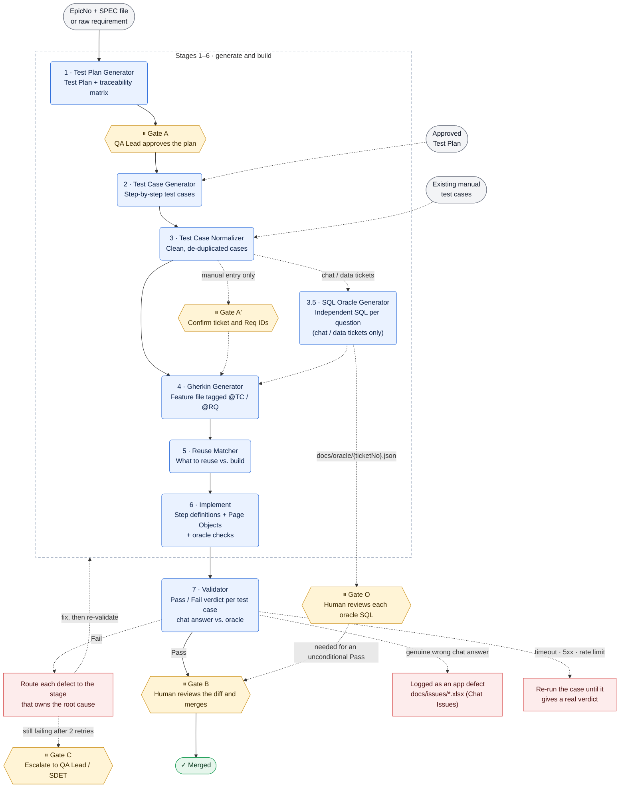
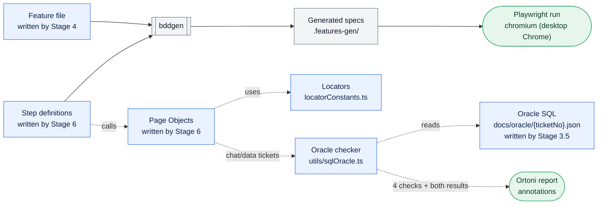

# Testroid Pipeline

Testroid turns an Epic + SPEC file into validated, merge-ready UI automation using seven core agents, plus an eighth, the **SQL Oracle Generator (Stage 3.5)**, for tickets whose expected result is a figure in the connected database (EleviqAI chat questions). They write Cucumber/Gherkin feature files and step definitions on top of a Page Object Model, and `playwright-bdd` compiles them into Playwright tests. This project automates UI flows only. There is no API or native mobile app track; the oracle checks read the app's own API from inside the signed-in page only to compare the chat's answer with the database.

Every artifact is keyed to one `{ticketNo}` and written to a fixed path, so any stage (or person) can find any other stage's output without guessing.

---

## Pipeline Flow

You give a starting input to the **[Pipeline Orchestrator](./PipelineOrchestratorAgent.md)**. It runs the whole flow below automatically and pauses only at the ⏸ gates, where a person has to act.

**Reading the diagram:** blue boxes are agent stages. ⏸ hexagons are human gates, the only places the run stops. Grey ovals are the possible starting inputs. Dotted arrows show the optional paths (manual entry, the Stage 3.5 oracle for chat/data tickets) and the failure handling. Gate O does not stop the run: tests run against a draft oracle, but a Pass stays conditional until a person approves the oracle SQL.

---

## How to Run the Pipeline

Don't invoke the stage agents by hand one at a time. Give the Orchestrator whichever input you have, and it starts at the matching stage:

| You have… | Pipeline starts at | Human gate on this path |
|---|---|---|
| An `EpicNo` + SPEC file, or a raw requirement | Stage 1 | Gate A, after the Test Plan |
| An already-approved Test Plan | Stage 2 | None until Gate B |
| Existing manual test cases | Stage 3 | Gate A′, before Stage 4 ([details](#alternate-entry-point-manual-test-cases)) |

Once started, the Orchestrator:

- **Chains stages back-to-back.** Each stage's output is fed straight into the next one. Finishing a stage is never a reason to stop.
- **Runs Stage 3.5 for chat/data tickets.** When the expected result is a figure in the connected database, the SQL Oracle Generator writes `docs/oracle/{ticketNo}.json` between Stage 3 and Stage 4.
- **Stops only at the ⏸ gates (A, A′, B, C; Gate O is a review that never blocks the run).** When a person responds, it resumes from that exact point, not from Stage 1.
- **Re-runs environment failures.** A test that fails because the app timed out, did not load, returned HTTP 5xx, answered "network error" or hit a rate limit is re-run until it gives a real verdict. Only a genuine mismatch counts as a Fail, and it is re-run once to confirm. Assertions are never loosened.
- **Retries failures automatically.** On a Stage 7 Fail it sends each defect to the stage that owns it, re-runs the downstream stages, and validates again. It does this up to 2 times, then escalates to Gate C.

---

## Stages

| Stage | Agent | Reads | Writes |
|---|---|---|---|
| — | [Pipeline Orchestrator](./PipelineOrchestratorAgent.md) | Any input from the table above | Drives Stages 1–7, pausing only at gates |
| 1 | [Test Plan Generator](./TestPlanGeneratorAgent.md) | `EpicNo`, SPEC file | `docs/Test Plans/{ticketNo}_test_plan.md` |
| 2 | [Test Case Generator](./TestCaseGeneratorAgent.md) | Approved Test Plan, module/scenario scope, detail prompt | `docs/test_cases/{ticketNo}.md` |
| 3 | [Test Case Normalizer](./TestCaseNormalizerAgent.md) | Stage 2 output **or** manual test cases | `docs/normalizer/{ticketNo}.md` |
| 3.5 | [SQL Oracle Generator](./SqlOracleAgent.md) (chat/data tickets only) | Normalized cases + live schema via Data Explorer | `docs/oracle/{ticketNo}.json` (Gate O: human reviews each oracle SQL) |
| 4 | [Gherkin Generator](./GherkinGeneratorAgent.md) | Normalized test cases | `features/{epic}/{ticketNo}.feature` |
| 5 | [Reuse Matcher](./ReuseMatcherAgent.md) | Normalized cases + feature file + existing `step-definitions/**`, `pages/**` | `docs/reuse_map/{ticketNo}.md` |
| 6 | [Implement](./ImplementAgent.md) | Feature file + reuse map (+ oracle file for chat/data tickets) | `step-definitions/{module}/*.steps.ts`, `pages/{module}/*.ts`, `locators/locatorConstants.ts`; for chat/data tickets also the oracle checker `utils/sqlOracle.ts` |
| 7 | [Quality Check / Validator](./ValidatorAgent.md) | Everything above + live test runs | `docs/validation/{ticketNo}.md`; for chat/data tickets also the issues workbook `docs/issues/*.xlsx` |

---

## How a Scenario Becomes a Running Test

Stage 4 writes the feature file, and Stage 6 writes the code behind it. `bddgen` combines the two into the Playwright specs that actually run.

For chat/data tickets the last step of each scenario (`the answer matches the database oracle for "<caseId>"`) reads the chat's answer and SQL, re-runs that SQL and the oracle SQL through Data Explorer (SELECT only), and makes four checks: **Answer**, **Consistency**, **Faithfulness** and **Correctness**. A case may list accepted alternative readings (for example a daily instead of a monthly trend); the report names which one matched. See [SqlOracleAgent.md](./SqlOracleAgent.md).

Every failed run also gives the chat's answer a thumbs down ("Bad response", then "Ok" in the app's dialog, no comment), and the report and the issues workbook's **Thumbs Down Log** record the saved message ID. Scenarios are paced: each starts at least 20 s after the previous one finished, and only once `/api/health` answers (`SCENARIO_GAP_MS`, `HEALTH_MAX_WAIT_MS`). See `docs/implementation/001.md`.

- `.features-gen/` is a build artifact. Never edit it by hand: fix the feature file or step definition, then regenerate. Every `npm test*` script runs `bddgen` first.
- `bddgen` fails if any Gherkin step has no step definition (undefined) or matches more than one (ambiguous). Stage 6 must fix that before it can report done.

---

## Feedback Loop

Stage 7 is the only stage that sends work backward. Each defect goes to **the stage that owns its root cause**, not automatically to Stage 6:

| Root cause | Routed back to |
|---|---|
| Requirement/scope was misread or incomplete | Stage 1 — Test Plan Generator |
| Test case steps/data don't match the requirement | Stage 2 — Test Case Generator |
| Schema violation, duplicate not merged, inconsistent terminology | Stage 3 — Test Case Normalizer |
| Scenario doesn't reflect the normalized case, missing scenario, wrong/missing traceability tag | Stage 4 — Gherkin Generator |
| Reuse misclassified (e.g. claimed Full Reuse but the asset doesn't exist) in `pages/**` or `step-definitions/**` | Stage 5 — Reuse Matcher |
| Code doesn't implement the scenario correctly, convention violation, regression, `bddgen` undefined/ambiguous step | Stage 6 — Implement |
| Oracle SQL is wrong (wrong table, metric definition or period), or a reasonable reading of the question is missing from `alternatives` | Stage 3.5 — SQL Oracle Generator |
| The chat's answer is genuinely wrong (checked against a correct oracle) | Not routed: logged as an app defect on the **Chat Issues** sheet of `docs/issues/*.xlsx` for the dev team |
| The app timed out, did not load, returned HTTP 5xx or hit a rate limit | Not routed: the case is re-run until it gives a real verdict, and the outage is logged on the **Other Issues** sheet |

Each Fail verdict produces an itemized defect list, with file/line references (or section references for the Markdown and Gherkin stages), addressed to the responsible agent. That agent fixes only the cited defects and resubmits. A **Pass** verdict closes the pipeline, and the change is merge-ready.

**Loop cap:** 2 automatic retries (3 validation attempts in total) per `{ticketNo}`, counted separately for each root-cause stage. If the same root cause is still failing after that, Stage 7 stops looping and escalates to **Gate C** with a summary of every attempt.

---

## Guardrails

Testroid writes code and runs tests, so its autonomy is deliberately limited. These rules apply to **every agent**, on top of each agent's own constraints, and are enforced through the [`guardrails`](../../skills/guardrails/SKILL.md) skill.

### Human-in-the-Loop (HITL) Gates

| Gate | After stage | Trigger | Who / what unblocks it |
|---|---|---|---|
| **A — Plan Approval** | 1 | A Test Plan can't drive Stage 2 until `Reviewed By` and `Approved By` (Section 1 of the plan) are filled in by a person. An unapproved plan may still be drafted and iterated on, just not used downstream. | QA Lead / Product Owner sign-off |
| **A′ — Manual Entry Confirmation** | 3 (manual entry only) | Manually entered test cases (bypassing Stages 1–2) have no `Req ID` by default. Before Stage 4 proceeds, a person confirms the `{ticketNo}` and, if one exists, the correct `Req ID` linkage. | Whoever supplied the manual test cases |
| **O — Oracle Review** | 3.5 (chat/data tickets only) | Every oracle SQL in `docs/oracle/{ticketNo}.json` is a draft until a person sets `reviewStatus` to `Approved by <name>, <date>`. It does not block the run: tests run against the draft, the report labels it DRAFT, and a Stage 7 Pass stays conditional. | Owner of the metric definitions (decisions D-A to D-C) |
| **B — Merge Approval** | 7 | A Stage 7 **Pass** is a recommendation, never an auto-merge trigger. A person reviews the actual diff and the Validation Report before any `git commit` / `push` / `merge`. | Code reviewer / repo owner |
| **C — Loop Escalation** | 7 → 6/5/4/3/2/1 | After 2 automatic Fail→fix retries for the same `{ticketNo}` and root cause, the loop halts and a person is brought in with the full attempt history. | QA Lead / SDET |

### Pipeline-Wide Safety Rules

- **No autonomous git operations.** No agent runs `git commit`, `git push`, `git merge`, `git rebase`, or any force/destructive git command. Stage 6 edits files; a person commits them.
- **No autonomous deploys or publishes.** No agent runs deploy, release, or `npm publish`-style commands.
- **File scope allowlisting.** Only these stages write code or code-adjacent files, each to its own non-overlapping paths:
  - Stage 3.5 (SQL Oracle Generator) may only touch `docs/oracle/**`.
  - Stage 4 (Gherkin Generator) may only touch `features/**`.
  - Stage 6 (Implement) may only touch `pages/**`, `locators/locatorConstants.ts`, and `step-definitions/**`; for chat/data tickets also the oracle checker `utils/sqlOracle.ts` (added at the owner's request).
  - No stage ever hand-writes `.features-gen/**`; it's regenerated by `bddgen`.
  - Neither stage may modify `playwright.config.ts`, `global-setup.ts`, `global-teardown.ts`, `.env`, `package.json`, CI/CD pipeline files, or anything under `docs/agents/` without an explicit, separate instruction from a person.
- **No deletion of existing passing tests or methods.** Agents add code or make the minimal documented edit. Full Reuse assets (per the Reuse Mapping Report) are strictly read-only in Stage 6.
- **Anti-fabrication.** Every stage marks unknowns as **TBD** rather than inventing business data, credentials, locators, Gherkin steps, expected results, or test outcomes. This is the single most important rule: a fabricated "Pass," Page Object method, or scenario is worse than an honest gap.
- **No real credentials, PII, or secrets.** Test data comes from the project's `randomData`/fixture generation, never real user data. If an input appears to contain a real secret or PII, the receiving agent halts and flags it instead of passing it downstream.
- **Shared-environment caution.** Treat the system under test (whatever `BASE_URL` points at) as shared and non-isolated unless it's verifiably private/disposable. No test may cause irreversible, costly, or disruptive side effects beyond what the existing example specs already establish as acceptable. Load generation, destructive admin actions, and spam account creation are out of scope.
- **Verification before claiming success.** No agent reports a check, test, or verdict as passing without actually running it, or explicitly marks it Blocked/TBD if it couldn't run. For Stage 6 this includes actually running `bddgen`.
- **Audit trail.** Every stage's output file carries a header with `{ticketNo}`, date, and pipeline stage, so the chain from requirement to merged code can be reconstructed later.

---

## Traceability Contract

A single `Req ID` / `Test Case ID` pair is assigned in Stage 1 (or left `TBD` for manually entered cases) and must survive **unchanged** through Stage 7. The chain looks like this: `RQ-01` → `TC-01` → `@TC-01 @RQ-01` scenario tags → generated test → Validator verdict.

| Stage | Responsibility for the IDs |
|---|---|
| 1 — Test Plan Generator | Assigns `RQ-##` and `TC-##` in the Requirement Traceability Matrix |
| 2 — Test Case Generator | Must not alter them when expanding a row into a full test case |
| 3 — Test Case Normalizer | Must not alter them. May only merge true duplicates (recording the merge) or reject cases missing a `Req ID` (recording the rejection, or marking `TBD` for manual entries). Never drops a case silently |
| 3.5 — SQL Oracle Generator | Must not alter them. Keys every oracle by its `Test Case ID`, with the question text copied exactly from the normalized case |
| 4 — Gherkin Generator | Must not alter them. Carries both forward as `@{testCaseId}` / `@{reqId}` tags on every `Scenario:` line |
| 5 — Reuse Matcher | Must not alter them. Gives every case exactly one classification (Full Reuse / Partial Reuse / Net New / Unverifiable), cited against real code, never guessed |
| 6 — Implement | Implements only Net New / Partial Reuse and leaves Full Reuse untouched. Each scenario stays traceable through the Stage 4 tag; never invents an ID of its own |
| 7 — Validator | Independently verifies the whole chain, including the feature file's tags, and gives a Pass / Fail / Blocked verdict per `Test Case ID` with cited evidence |

---

## Platform Coverage (Mobile Web)

> **Currently desktop only.** `playwright.config.ts` defines only the `chromium` (Desktop Chrome) project, and `npm test` runs only that (project owner's decision, 2026-11-19). The rules below apply only if a `mobile-chrome` project is added back. Until then, a `Platform: Mobile`/`Both` case is flagged to the user at Stage 6 instead of being run on mobile, and Stage 7 reports its mobile execution as Not applicable.

Each test case has a **`Platform`**: `Desktop`, `Mobile`, or `Both`. It's set in Stage 2, preserved through Stage 3, and used by Stages 5–7. "Mobile" here means Playwright device emulation of the same site (`mobile-chrome` project, `devices['Pixel 5']`), not a native app and not a separate agent. The same step definitions and Page Objects drive both `chromium` and `mobile-chrome`.

- **Stage 2** assigns `Platform` per case: the Test Plan's Device Coverage scope for that module, or `TBD` if it doesn't say. Never assumed.
- **Stage 5** treats step definitions, Page Objects, and locators as platform-agnostic, but flags a scenario as *not actually covered on mobile* if the matched code already has a `mobile-chrome`-only skip/guard.
- **Stage 6** writes one implementation for both projects. Mobile-only differences are isolated to a guarded assertion, never a forked implementation. A confirmed live-site mobile-only defect is skipped with cited evidence, never masked by loosening the assertion. See [ImplementAgent.md's Mobile Web Testing section](./ImplementAgent.md#mobile-web-testing) for the concrete rules: no `force: true` to dodge animation races, no hardcoded desktop-only DOM order, and respect the `isMobile`-aware viewport guard in `fixtures/testFixture.ts`.
- **Stage 7** also runs `npx playwright test --project=mobile-chrome` for any `Platform: Mobile`/`Both` case, and checks that any mobile-only skip cites a real, verified defect.

---

## Alternate Entry Point: Manual Test Cases

Stage 3 (Test Case Normalizer) accepts two kinds of input:

1. **Pipeline-generated:** `docs/test_cases/{ticketNo}.md` from Stage 2. This is the default path.
2. **Manually authored:** existing hand-written test cases (Markdown, Excel, CSV, or legacy documents) supplied directly, bypassing Stages 1 and 2.

Both paths produce the same normalized output (`docs/normalizer/{ticketNo}.md`) in the same schema, so Stage 4 onward never needs to know which path a ticket took. Manually entered cases may have no `Req ID`. The Normalizer marks it **TBD** rather than inventing one, and **Gate A′** has a person confirm the linkage before Stage 4 runs (see [TestCaseNormalizerAgent.md](./TestCaseNormalizerAgent.md)).

---

## Naming Conventions

| Placeholder | Meaning | Example |
|---|---|---|
| `{epicNo}` | Jira/Azure DevOps Epic identifier. Groups related tickets/features | `EPIC-123` |
| `{ticketNo}` | Individual Story/Task/ticket identifier. Every artifact for one feature is keyed to it | `EPIC-123-45` |
| `{module}` | Functional area a Page Object or step definition file belongs to: `pages/{module}/*.ts`, `step-definitions/{module}/*.steps.ts` | `category`, `cart`, `checkout` |
| `{epic}` | Lowercase epic folder name grouping feature files: `features/{epic}/{ticketNo}.feature` | `category-navigation` |

---

## Output Location Convention

| Artifact | Path |
|---|---|
| Test Plan | `docs/Test Plans/{ticketNo}_test_plan.md` |
| Detailed Test Cases | `docs/test_cases/{ticketNo}.md` |
| Normalized Test Cases (Markdown + JSON) | `docs/normalizer/{ticketNo}.md` |
| Gherkin Feature File | `features/{epic}/{ticketNo}.feature` |
| SQL Oracle (chat/data tickets) | `docs/oracle/{ticketNo}.json` |
| Reuse Mapping Report | `docs/reuse_map/{ticketNo}.md` |
| Implementation code | `step-definitions/{module}/*.steps.ts`, `pages/{module}/*.ts`, `locators/locatorConstants.ts` |
| Generated specs (never hand-written) | `.features-gen/**` |
| Implementation Summary | `docs/implementation/{ticketNo}.md` |
| Validation Report | `docs/validation/{ticketNo}.md` |
| Issues workbook for the dev team (Chat Issues + Other Issues sheets) | `docs/issues/*.xlsx` |

> `pages/{module}/*.ts` and `step-definitions/{module}/*.steps.ts` are the **target** convention for pipeline-generated output. Pre-existing flat files (e.g. a `pages/LoginPage.ts` directly under `pages/`) aren't moved unless a migration is explicitly requested. `pages/sample/SampleHomePage.ts`, `features/sample/sample-homepage.feature`, and `step-definitions/sample/sample-homepage.steps.ts` are an illustrative placeholder that proves the BDD wiring works, not a real ticket.

---

## Skills

Three Claude Code Skills turn the rules above into reusable instructions, so no stage has to work them out again:

| Skill | Applies to | Covers |
|---|---|---|
| [`guardrails`](../../skills/guardrails/SKILL.md) | All stages (1–7 and 3.5) + the Orchestrator | The [Traceability Contract](#traceability-contract) and [Guardrails](#guardrails) sections: HITL gates, anti-fabrication, safety rules |
| [`testroid-bdd-conventions`](../../skills/testroid-bdd-conventions/SKILL.md) | Stages 4, 5, 6 | Gherkin style, `@{testCaseId}`/`@{reqId}` tag traceability, the step definition → Page Object convention, and the `bddgen` build step |
| [`testroid-locator-conventions`](../../skills/testroid-locator-conventions/SKILL.md) | Stages 5, 6 | The `LocatorStrategyList` fallback pattern, `BasePage` primitives, and Page Object conventions |
